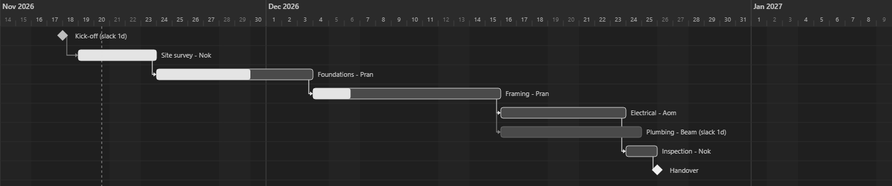

<b>Plans and Gantt timelines</b> Version 1.0.2 for Windows · Free · Offline · No account

<a href="https://github.com/plawanpawin-byte/planout/releases/latest"><b>Download Planout</b></a> · <a href="https://github.com/plawanpawin-byte/Lookout">All Lookout apps</a>

---

Planout turns a list of tasks into a project plan. Give each task a start date, a length and an owner, link tasks that depend on each other, and watch the Gantt timeline update. When a task slips, everything that waits for it moves too.

**Made for:** Project managers, freelancers, event organisers, builders and students: anyone who needs to see what happens when, and who is doing it.

**On this page:** [Screenshots](#see-it-in-action) · [Interface](#the-interface) · [Features](#everything-it-can-do) · [How to use it](#how-to-use-it) · [Shortcuts](#keyboard-shortcuts) · [Formats](#files-and-formats) · [Privacy](#private-by-design) · [Install](#install) · [Questions](#questions)

## What is new in 1.0.2

A refreshed interface: every toolbar button now has a clear line icon, the app's mark sits at the top left, controls share one height and spacing, panels line up in tidy grids, and the toolbar keeps every button reachable on smaller windows by switching less important buttons to icons.

## See it in action

### The plan and its timeline

A task table on the left and a Gantt chart on the right. A dashed line marks today.

### Selecting a task

Click a row to highlight it in both the table and the chart. Progress shows as the filled part of each bar.

### Dependencies and milestones

A diamond marks a milestone. Arrows show which task waits for which, and dates follow automatically.

### Exported timeline image

The chart exported as a PNG for a status report or a slide.

### CSV output

Task names, dates, durations, progress and owners as a CSV file that opens in any spreadsheet.

## The interface

- **Top bar:** file buttons, Add task, Add milestone, delete and reorder, undo and redo, timeline zoom, Today, and Export CSV / PNG.
- **Task table (left):** number, name, start, days, done %, the task it comes after, and owner, all editable in place.
- **Timeline (right):** the Gantt chart with today marker, progress bars, milestones and dependency arrows. The status bar shows the finish date and overall progress.

## Everything it can do

### Tasks

- Name, start date, length in days, percent done and owner for every task
- Add task or milestone, move tasks up and down, delete
- Edit directly in the table

### Dependencies

- Choose which task each task comes after
- Start dates move automatically when an earlier task changes
- A link that would create a loop is refused

### Timeline

- Gantt chart with a month and day scale and a today marker
- Progress bars, milestone diamonds and dependency arrows
- Drag a bar to move it, drag its end to change its length
- Zoom in and out, and jump back to today

### Summary

- The status bar shows the number of tasks, the planned finish date and the overall percent complete

### Files and export

- Save and reopen .planout files
- Export the timeline as PNG
- Export the task list as CSV

## How to use it

1. Click **Add task** and type a name.
2. Set the start date and number of days. Use **Add milestone** for a zero-length marker.
3. In **After**, pick the task this one must wait for.
4. Type a percentage into **Done %** to fill the bar.
5. Press **Export PNG** to share the picture or **Export CSV** for a spreadsheet.

## Keyboard shortcuts

| Keys | What it does |
| --- | --- |
| Drag a bar | Move the task |
| Drag a bar's end | Change its length |
| Ctrl + Z / Y | Undo / redo |

## Files and formats

Saves .planout files. Exports PNG and CSV. Dates are written year-month-day, for example 2026-11-24.

## Private by design

- No account, no sign-in, no subscription, no ads.
- Planout works offline. It never sends your files, your text or anything about how you use it anywhere.
- Files are opened and saved only through the Windows file dialogs you use. Planout cannot browse your disk on its own.
- The app window runs in a locked-down sandbox with a strict content policy.

## Install

1. Open the [latest release](https://github.com/plawanpawin-byte/planout/releases/latest) and download the file named **Planout-Setup-** followed by the version number and **.exe**. You can also install it from the [Lookout launcher](https://github.com/${OWNER}/lookout-launcher), which keeps it up to date.
2. Run the installer. It installs just for you, so it does not ask for administrator rights.
3. Windows may show a blue **Windows protected your PC** screen because these installers are not signed with a paid certificate. Click **More info**, then **Run anyway**.
4. Open Planout from the Start menu.

**Requirements:** Windows 10 or 11, 64-bit. About 500 MB of free disk space. No internet connection is needed to use the app.

## Questions

**Does it know about weekends and holidays?**  
Not yet. Durations are counted in calendar days.

**Can two people edit one plan?**  
Share the .planout file. There is no live co-editing because nothing goes online.

## About Lookout

Planout belongs to the **[Lookout](https://github.com/plawanpawin-byte/Lookout)** family: ten small, private Windows apps for documents and media, all with the same calm grey look and the same promise that your files stay yours. Install and update them together with the [Lookout launcher](https://github.com/plawanpawin-byte/lookout-launcher).

- **[Pageout](https://github.com/plawanpawin-byte/pageout)**: read, annotate and sign pdfs
- **[Chartout](https://github.com/plawanpawin-byte/chartout)**: flowcharts and diagrams
- **[Branchout](https://github.com/plawanpawin-byte/branchout)**: mind maps and outlines
- **[Frameout](https://github.com/plawanpawin-byte/frameout)**: screen design and prototypes
- **[Cutout](https://github.com/plawanpawin-byte/cutout)**: video editing on a timeline
- **[Shiftout](https://github.com/plawanpawin-byte/shiftout)**: convert and compress media
- **[Castout](https://github.com/plawanpawin-byte/castout)**: record your screen
- **[Mendout](https://github.com/plawanpawin-byte/mendout)**: repair damaged media
- **[Tuneout](https://github.com/plawanpawin-byte/tuneout)**: record and edit audio

Released under the MIT License.
