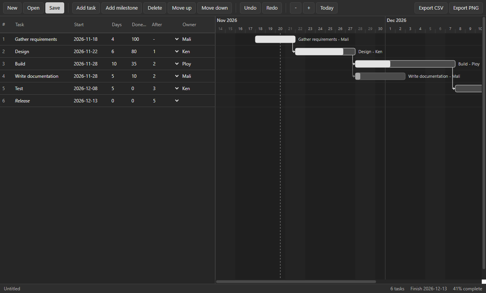

# Planout

A straightforward, private project planner for Windows. List your tasks, link them together and see the whole schedule on a Gantt timeline, with no account, no subscription and no internet connection.

## What you can do

- **Task table** with start date, length in days, percent done, predecessor and owner
- **Gantt timeline** with weekends shaded, a today marker and dependency arrows
- **Drag bars** to reschedule and drag the end to change the length
- **Dependencies** move later tasks automatically, and loops are blocked
- **Milestones** for key dates
- **Critical path** highlighted so you can see what drives the finish date
- Overall progress and project finish date in the status bar
- Reorder tasks, zoom the timeline, undo and redo
- **Export** the schedule as CSV or the timeline as a PNG image, or save a Planout file to continue later

## Your files stay on your computer

Planout has no account, no cloud and no tracking. Files are opened and saved only through the dialogs you use, and nothing is uploaded.

## Download

Get **Planout-Setup-1.0.0.exe** from the [Releases](../../releases/latest) page and run it.

Part of the [Lookout](https://github.com/plawanpawin-byte/Lookout) family of apps.

Released under the MIT License.
