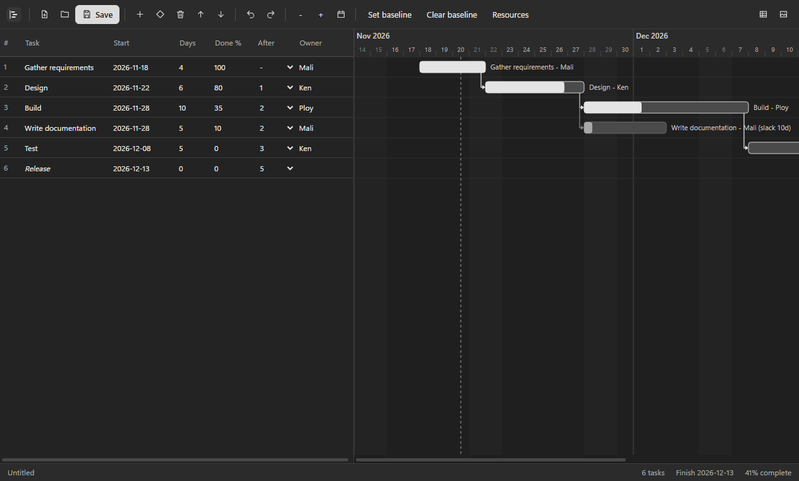
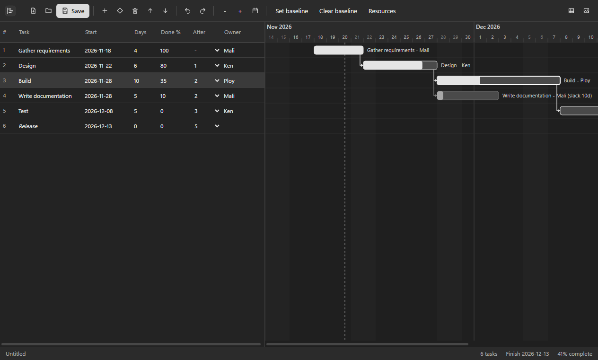

<h1 align="center">Planout</h1>

<b>Plans and Gantt timelines</b> Version 1.0.15 for Windows · Free · Offline · No account

<a href="https://github.com/plawanpawin-byte/planout/releases/latest"><b>Download Planout</b></a> · <a href="https://github.com/plawanpawin-byte/lookout-launcher">Lookout launcher</a> · <a href="https://github.com/plawanpawin-byte/Lookout">All Lookout apps</a>

---

Planout turns a list of tasks into a project plan. Give each task a start date, a length and an owner, link tasks that depend on each other, and watch the Gantt timeline update. When a task slips, everything that waits for it moves too.

**Made for:** Project managers, freelancers, event organisers, builders and students: anyone who needs to see what happens when, and who is doing it.

**On this page:** [In plain words](#in-plain-words) · [Who it is for](#who-it-is-for) · [Try it in 3 steps](#try-it-in-3-steps) · [Screenshots](#see-it-in-action) · [Features](#everything-it-can-do) · [How to use it](#how-to-use-it) · [Privacy](#private-by-design) · [Install](#install) · [Questions](#questions)

## In plain words

Planout is a **project planner**. You write a list of tasks, give each one a start date, a length in days and an owner, and Planout draws them as horizontal bars on a **Gantt timeline**, the standard chart that project managers use to see what happens when.

The useful part is **dependencies**. If task B cannot start until task A is finished, you link them. When A slips by two days, B and everything after it move automatically. You can also add **milestones** (important dates such as "Launch"), see a summary of the whole plan, and export the timeline as a picture or the task list as a CSV file that opens in Excel.

**Not for:** Planout plans tasks and dates. It does not track budgets, hours worked or file attachments, and it does not sync between people.

## Who it is for

- **Project managers** and team leads who need a simple plan without a heavy tool.
- **Small businesses** scheduling a launch, an event or a renovation.
- **Students** planning a group project or a thesis.

## Try it in 3 steps

1. Add three tasks. Give them lengths and an owner.
2. Link the second task to the first as a dependency and watch the bar move.
3. Export the timeline image and share it with your team.

## What is new in 1.0.15

A new look inspired by Google's own tools (AI Studio, Colab, Gemini): a calm dark charcoal theme, rounded pill buttons, a soft blue accent and roomier spacing. The app icon is now a colour logo so you can find Planout at a glance in the Start menu and in the Lookout launcher. All screenshots below were taken again with the new look. The program now shows under its own name (not Electron) in Task Manager and the taskbar.

## In plain words

Planout is a **project planner**. You write a list of tasks, give each one a start date, a length in days and an owner, and Planout draws them as horizontal bars on a **Gantt timeline**, the standard chart that project managers use to see what happens when.

The useful part is **dependencies**. If task B cannot start until task A is finished, you link them. When A slips by two days, B and everything after it move automatically. You can also add **milestones** (important dates such as "Launch"), see a summary of the whole plan, and export the timeline as a picture or the task list as a CSV file that opens in Excel.

**Not for:** Planout plans tasks and dates. It does not track budgets, hours worked or file attachments, and it does not sync between people.

## Who it is for

- **Project managers** and team leads who need a simple plan without a heavy tool.
- **Small businesses** scheduling a launch, an event or a renovation.
- **Students** planning a group project or a thesis.

## Try it in 3 steps

1. Add three tasks. Give them lengths and an owner.
2. Link the second task to the first as a dependency and watch the bar move.
3. Export the timeline image and share it with your team.

## See it in action

### The plan and its timeline

A task table on the left and a Gantt chart on the right. A dashed line marks today.

### Selecting a task

Click a row to highlight it in both the table and the chart. Progress shows as the filled part of each bar.

### Dependencies and milestones

A diamond marks a milestone. Arrows show which task waits for which, and dates follow automatically.

### Exported timeline image

The chart exported as a PNG for a status report or a slide.

### CSV output

Task names, dates, durations, progress and owners as a CSV file that opens in any spreadsheet.

## The interface

- **Top bar:** file buttons, Add task, Add milestone, delete and reorder, undo and redo, timeline zoom, Today, and Export CSV / PNG.
- **Task table (left):** number, name, start, days, done %, the task it comes after, and owner, all editable in place.
- **Timeline (right):** the Gantt chart with today marker, progress bars, milestones and dependency arrows. The status bar shows the finish date and overall progress.

## Everything it can do

### Tasks

- Name, start date, length in days, percent done and owner for every task
- Add task or milestone, move tasks up and down, delete
- Edit directly in the table

### Dependencies

- Choose which task each task comes after
- Start dates move automatically when an earlier task changes
- A link that would create a loop is refused

### Timeline

- Gantt chart with a month and day scale and a today marker
- Progress bars, milestone diamonds and dependency arrows
- Drag a bar to move it, drag its end to change its length
- Zoom in and out, and jump back to today

### Summary

- The status bar shows the number of tasks, the planned finish date and the overall percent complete

### Files and export

- Save and reopen .planout files
- Export the timeline as PNG
- Export the task list as CSV

## How to use it

1. Click **Add task** and type a name.
2. Set the start date and number of days. Use **Add milestone** for a zero-length marker.
3. In **After**, pick the task this one must wait for.
4. Type a percentage into **Done %** to fill the bar.
5. Press **Export PNG** to share the picture or **Export CSV** for a spreadsheet.

## Keyboard shortcuts

| Keys | What it does |
| --- | --- |
| Drag a bar | Move the task |
| Drag a bar's end | Change its length |
| Ctrl + Z / Y | Undo / redo |

## Files and formats

Saves .planout files. Exports PNG and CSV. Dates are written year-month-day, for example 2026-11-24.

## Private by design

- No account, no sign-in, no subscription, no ads.
- Planout works offline. It never sends your files, your text or anything about how you use it anywhere.
- Files are opened and saved only through the Windows file dialogs you use. Planout cannot browse your disk on its own.
- The app window runs in a locked-down sandbox with a strict content policy.

## Install

1. Open the [latest release](https://github.com/plawanpawin-byte/planout/releases/latest) and download the file named **Planout-Setup-** followed by the version number and **.exe**. You can also install it from the [Lookout launcher](https://github.com/plawanpawin-byte/lookout-launcher), which keeps it up to date.
2. Run the installer. It installs just for you, so it does not ask for administrator rights.
3. Windows may show a blue **Windows protected your PC** screen because these installers are not signed with a paid certificate. Click **More info**, then **Run anyway**.
4. Open Planout from the Start menu.

**Requirements:** Windows 10 or 11, 64-bit. About 500 MB of free disk space. No internet connection is needed to use the app.

## Questions

**Does it know about weekends and holidays?**  
Not yet. Durations are counted in calendar days.

**Can two people edit one plan?**  
Share the .planout file. There is no live co-editing because nothing goes online.

**What is a Gantt chart?**  
A chart with tasks listed down the side and a calendar across the top. Each task is a bar from its start to its end.

**What happens when I change a date?**  
Any task that depends on it moves too, so the whole plan stays consistent.

**Can I open the plan in Excel?**  
Yes. Export the CSV and open it in Excel or any spreadsheet program.

**What is a Gantt chart?**  
A chart with tasks listed down the side and a calendar across the top. Each task is a bar from its start to its end.

**What happens when I change a date?**  
Any task that depends on it moves too, so the whole plan stays consistent.

**Can I open the plan in Excel?**  
Yes. Export the CSV and open it in Excel or any spreadsheet program.

## About Lookout

Planout is part of **[Lookout](https://github.com/plawanpawin-byte/Lookout)**: ten small, private Windows apps for documents and media that share one look and one promise, that your files stay on your computer. Install and update them together with the [Lookout launcher](https://github.com/plawanpawin-byte/lookout-launcher).

| | App | What it is for | Code |
| --- | --- | --- | --- |
|  | **Lookout** | Install, open and update all the apps below | [GitHub](https://github.com/plawanpawin-byte/lookout-launcher) |
|  | **PDFout** | Read, annotate and sign PDFs | [GitHub](https://github.com/plawanpawin-byte/pdfout) |
|  | **Chartout** | Flowcharts, org charts and diagrams | [GitHub](https://github.com/plawanpawin-byte/chartout) |
|  | **Branchout** | Mind maps and outlines | [GitHub](https://github.com/plawanpawin-byte/branchout) |
|  | **Planout** | Project plans and Gantt timelines | [GitHub](https://github.com/plawanpawin-byte/planout) |
|  | **Frameout** | App and web screen design with click-through prototypes | [GitHub](https://github.com/plawanpawin-byte/frameout) |
|  | **Cutout** | Video editing on a timeline | [GitHub](https://github.com/plawanpawin-byte/cutout) |
|  | **Shiftout** | Convert and compress video and audio, make GIFs | [GitHub](https://github.com/plawanpawin-byte/shiftout) |
|  | **Castout** | Record your screen | [GitHub](https://github.com/plawanpawin-byte/castout) |
|  | **Mendout** | Check and repair damaged video, audio, pictures and PDFs | [GitHub](https://github.com/plawanpawin-byte/mendout) |
|  | **Tuneout** | Record and edit audio | [GitHub](https://github.com/plawanpawin-byte/tuneout) |

Released under the MIT License.
